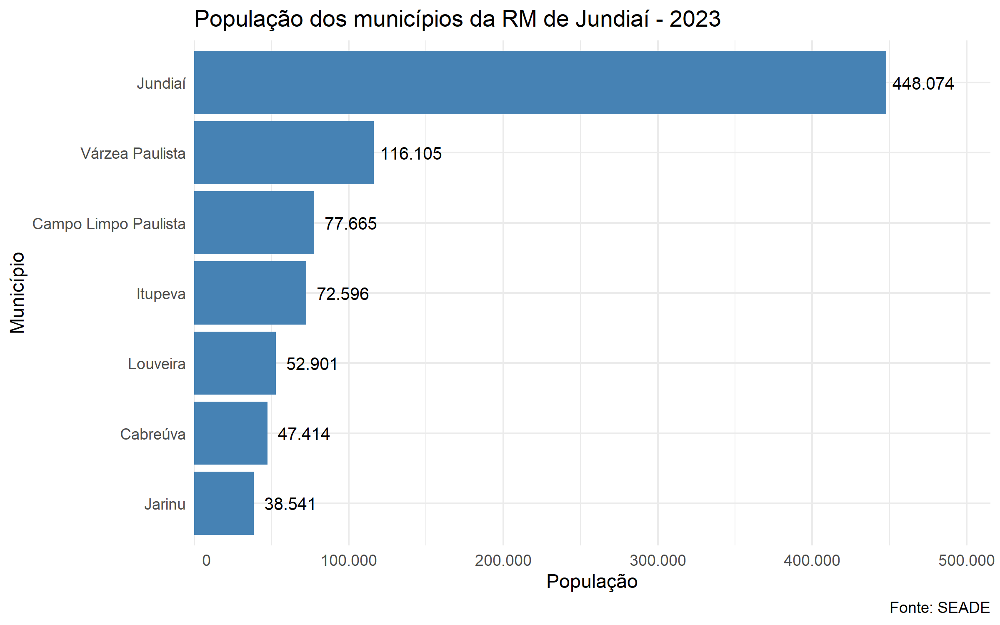
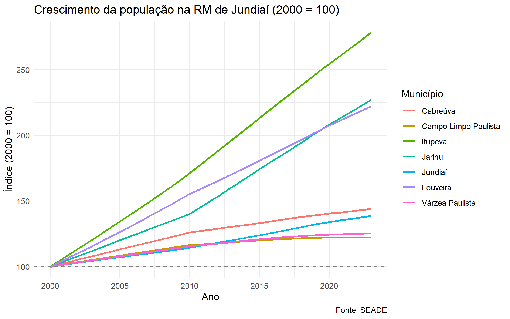
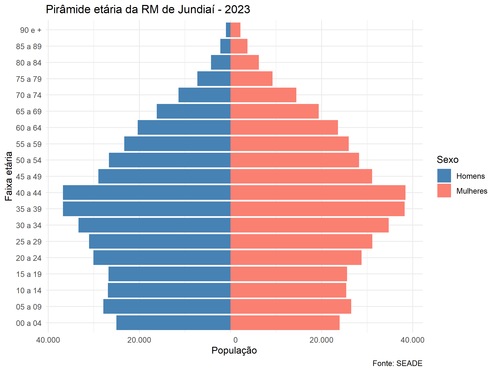
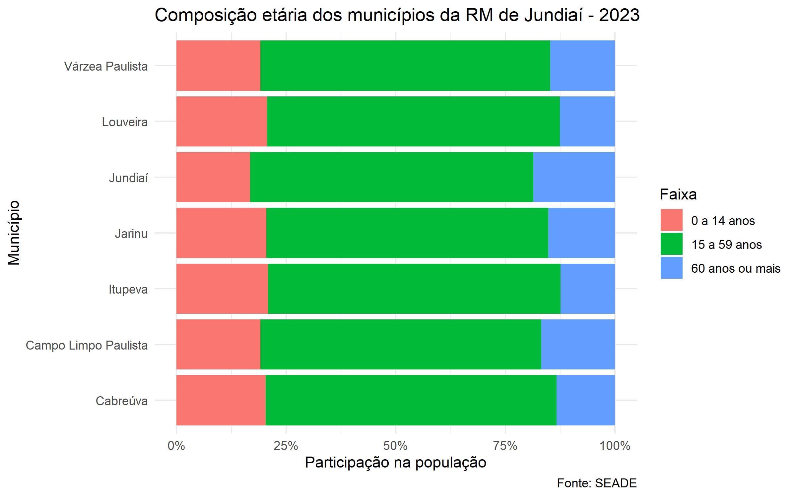
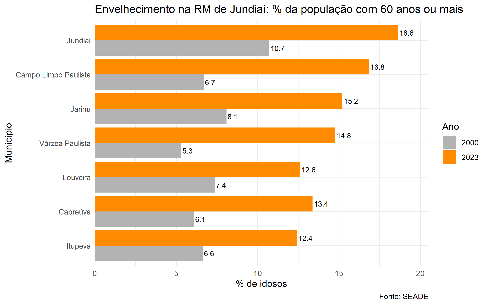

# Guia passo a passo: 5 gráficos da Região Metropolitana de Jundiaí

Este guia mostra **como** o script `tarefa_aula09_graficos_RMJD_WellingtonTorres.R` foi construído:
em cada etapa vem primeiro a teoria (por que fazer) e depois o código (como fazer).

**Enunciado:** *"Criar 5 gráficos da região metropolitana de Jundiaí"*

**Material recebido:**

| Arquivo | Conteúdo |
|---------|----------|
| `estimativa_pop_idade_sexo_esp (2).csv` | Estimativa de população do SEADE para os 645 municípios de SP, de 2000 a 2023, por sexo e faixa etária (577.920 linhas) |
| `RM JUNDIAI (2).xlsx` | Lista dos 7 municípios da RMJD com o código do IBGE |

**Pacotes:** `readr` (ler o CSV), `openxlsx` (ler o Excel), `dplyr` (tratar), `ggplot2` (desenhar).

---

## Etapa 0 - Planejar antes de programar

> **Teoria:** um gráfico responde a **uma pergunta**. Se você começar pelo código ("vou fazer um
> gráfico de barras"), corre o risco de fazer 5 gráficos que dizem a mesma coisa. Comece pelas
> perguntas e escolha o tipo de gráfico que melhor responde cada uma.

Olhando as colunas da base (`ano`, `municipio`, `sexo`, `idade`, `populacao`), dá para fazer
perguntas sobre **tamanho**, **tempo**, **estrutura por idade/sexo** e **mudança**:

| # | Pergunta | Tipo de gráfico | Por que esse tipo |
|---|----------|-----------------|-------------------|
| 1 | Qual o tamanho de cada município? | Barras horizontais | Comparar valores entre categorias; horizontal porque os nomes são longos |
| 2 | Quem cresceu mais desde 2000? | Linhas | Evolução no tempo |
| 3 | Como a população se distribui por idade e sexo? | Pirâmide etária | É o gráfico padrão da demografia para idade × sexo |
| 4 | Qual município é mais jovem ou mais velho? | Barras empilhadas 100% | Comparar **proporções** quando os totais são muito diferentes |
| 5 | A região está envelhecendo? | Barras lado a lado | Comparar dois momentos (2000 × 2023) dentro de cada categoria |

Os 5 tipos foram vistos nas Aulas 07/08 (exemplos 4, 5, 6, 7 e 12 do `resumo.txt`).

---

## Etapa 1 - Preparar o ambiente

> **Teoria:** um script tem que rodar em qualquer computador. Por isso:
> - `rm(list=ls())` limpa a memória, para nenhum objeto antigo "ajudar" sem você perceber;
> - caminhos **relativos** (`"Aula09"`), e não absolutos (`"C:/Users/fulano/..."`). O `.Rproj`
>   faz o RStudio abrir já com a pasta de trabalho em `Aulas_R`;
> - `file.path()` monta o caminho com a barra certa;
> - `file.exists()` confere o caminho **antes** de ler, e o erro fica óbvio.

```r
rm(list=ls())

BASE<-"Aula09"
SAIDA<-file.path(BASE, "graficos")
dir.create(SAIDA, showWarnings = FALSE)   # pasta onde os PNGs serão salvos

file.exists(file.path(BASE, "estimativa_pop_idade_sexo_esp (2).csv"))   # TRUE
file.exists(file.path(BASE, "RM JUNDIAI (2).xlsx"))                     # TRUE

library(readr)
library(openxlsx)
library(dplyr)
library(ggplot2)
```

---

## Etapa 2 - Ler os dados (e acertar o encoding)

> **Teoria - encoding:** o computador grava letras como números. Existem tabelas diferentes
> para essa conversão: o **UTF-8** é o padrão moderno, e o **Latin-1** (ISO-8859-1) é muito usado
> por órgãos públicos brasileiros. Se você ler com a tabela errada, os acentos quebram:
> `Jundiaí` vira `Jundia�`.

Descobrir antes de ler:

```r
readr::guess_encoding("Aula09/estimativa_pop_idade_sexo_esp (2).csv")
#   encoding   confidence
# 1 ISO-8859-1       0.89     <- Latin-1
```

> **Teoria - formato brasileiro:** o CSV do SEADE usa `;` para separar colunas e `,` como
> decimal. O `read_csv2()` já espera esse formato. O `read_csv()` (sem o 2) espera `,` e `.`.

```r
pop_est_sp<-read_csv2(file.path(BASE, "estimativa_pop_idade_sexo_esp (2).csv"),
                      locale = locale(encoding = "latin1"),
                      show_col_types = FALSE)

reg_metro_jd<-read.xlsx(file.path(BASE, "RM JUNDIAI (2).xlsx"),
                        startRow = 1,
                        colNames = T)
```

---

## Etapa 3 - Conhecer os dados antes de usar

> **Teoria:** nunca confie que a base está limpa. Antes de qualquer conta, olhe **tipos**
> (`str`), **valores possíveis** (`table`, `unique`) e **valores faltantes** (`is.na`).
> Os erros mais perigosos não dão mensagem de erro: o código roda e o número sai errado.

```r
str(pop_est_sp)
reg_metro_jd
table(is.na(pop_est_sp$ano))
table(pop_est_sp$idade)
```

Essa inspeção revelou **quatro armadilhas**:

| Armadilha | Como apareceu | Consequência se ignorar |
|-----------|---------------|-------------------------|
| Linha `idade == "Total"` em cada município/ano/sexo | `table(idade)` mostra "Total" junto das faixas | A soma da população sai **dobrada** |
| 1.290 linhas vazias no fim do arquivo (`;;;;;`) | `is.na(ano)` dá `TRUE` em 1.290 linhas | Linhas de `NA` nos resumos |
| Faixas diferentes antes de 2011 | 2000-2010 terminam em `"75 e +"`; depois vão até `"90 e +"` | Pirâmides de anos diferentes não se comparam faixa a faixa |
| `IBGE` é texto no Excel; `cod_ibge` é número no CSV | `str()` mostra `chr` × `num` | O join falha (tipos diferentes não casam) |

Bônus: no Excel está escrito `"Várzea Paulista."`, com ponto. Por isso os nomes vêm do CSV.

> **Teoria - dados "tidy" (arrumados):** numa base arrumada, cada linha é **uma** observação.
> A linha "Total" quebra essa regra, porque ela é um *resumo* das outras linhas misturado com
> os dados. Sempre que uma base trouxer subtotais, remova-os e deixe o `sum()` fazer a conta.

---

## Etapa 4 - Tratar: filtrar e cruzar as tabelas

> **Teoria - join:** precisamos só dos 7 municípios da RMJD, que estão listados em **outra
> tabela**. O **inner join** cruza as duas tabelas por uma coluna em comum (a *chave*, aqui
> o código do IBGE) e mantém só as linhas que existem **nas duas**. É a mesma ideia do `merge()`
> da Tarefa 004, agora na versão do dplyr.
>
> ```
>  pop_est_sp (645 municípios)      reg_metro_jd (7 municípios)
>  cod_ibge  nome_mun                IBGE     CIDADE
>  3500105   Adamantina   ✗          3508405  Cabreúva
>  3508405   Cabreúva     ✓  <---->  3525904  Jundiaí
>  3525904   Jundiaí      ✓  <---->  ...
>  ...                     resultado: só os ✓
> ```

Primeiro igualamos os tipos da chave, depois filtramos e cruzamos:

```r
reg_metro_jd$IBGE<-as.numeric(reg_metro_jd$IBGE)

pop_rmjd<-pop_est_sp %>%
  filter(!is.na(ano), idade != "Total") %>%                   # tira linhas vazias e subtotais
  inner_join(reg_metro_jd, by = c("cod_ibge" = "IBGE"))     # fica só a RMJD
```

`by = c("cod_ibge" = "IBGE")` quer dizer: a coluna `cod_ibge` da esquerda casa com a coluna
`IBGE` da direita (os nomes são diferentes, então é preciso dizer qual é qual).

**Conferência:**

```r
n_distinct(pop_rmjd$cod_ibge)   # 7  municípios
n_distinct(pop_rmjd$ano)        # 24 anos (2000 a 2023)
```

---

## Etapa 5 - Criar variáveis novas

> **Teoria:** a base tem 19 faixas de 5 anos. Para os gráficos 4 e 5 precisamos de 3 faixas
> amplas, que são o padrão em demografia: **crianças (0-14)**, **idade ativa (15-59)** e
> **idosos (60+)**. O `mutate()` cria colunas novas a partir das existentes.

O truque: os dois primeiros caracteres da faixa são a idade inicial (`"60 a 64"` → `60`;
`"75 e +"` → `75`). O `substr()` recorta esse pedaço e o `case_when()` classifica:

```r
pop_rmjd<-pop_rmjd %>%
  mutate(idade_ini = as.numeric(substr(idade, 1, 2)),
         faixa = case_when(idade_ini < 15 ~ "0 a 14 anos",
                           idade_ini < 60 ~ "15 a 59 anos",
                           TRUE           ~ "60 anos ou mais"))
```

O `case_when()` testa as condições **em ordem** e para na primeira verdadeira. O `TRUE` no
final significa "todo o resto". Esse método resolve a armadilha das faixas antes de 2011:
`"75 e +"` começa em 75, então cai em "60 anos ou mais" de qualquer jeito.

---

## Etapa 6 - Validar antes de desenhar

> **Teoria:** se o dado tratado estiver errado, o gráfico vai ficar bonito **e errado**.
> Uma boa validação compara seu resultado com uma fonte independente. Aqui, a própria base
> traz as linhas "Total": a soma das faixas tem que bater com elas.

```r
pop_rmjd %>% filter(ano == 2023) %>% summarise(pop = sum(populacao))
# 853296

pop_est_sp %>%
  filter(ano == 2023, idade == "Total", cod_ibge %in% reg_metro_jd$IBGE) %>%
  summarise(pop = sum(populacao))
# 853296   <- bateu
```

Se as linhas "Total" não tivessem sido removidas, o primeiro resultado daria 1.706.592 (o dobro).

---

## Etapa 7 - Os 5 gráficos

Todos seguem a mesma receita das Aulas 07/08:

```r
dados_resumidos <- base %>% filter(...) %>% group_by(...) %>% summarise(...)   # 1. preparar

ggplot(dados_resumidos, aes(x = ..., y = ..., fill/color = ...)) +             # 2. mapear
  geom_...() +                                                                 # 3. desenhar
  labs(title = ..., x = ..., y = ..., caption = "Fonte: SEADE")                # 4. rotular
```

> **Teoria - resumir antes de plotar:** a base da RMJD tem milhares de linhas (município ×
> ano × sexo × faixa). O gráfico precisa de **uma linha por barra/ponto**. Então primeiro se
> faz o `group_by() + summarise()` e só depois o `ggplot()`.

### Gráfico 1 - População por município (barras horizontais)

> **Teoria:** use barras para comparar quantidades entre categorias. O `geom_col()` usa o valor
> que você calculou (o `geom_bar()` contaria linhas). O `reorder()` ordena as barras pelo valor,
> e assim o ranking fica visível. O `coord_flip()` deita as barras para os nomes caberem.

```r
pop_mun_2023<-pop_rmjd %>%
  filter(ano == 2023) %>%
  group_by(nome_mun) %>%
  summarise(populacao = sum(populacao))

g1<-ggplot(pop_mun_2023, aes(x = reorder(nome_mun, populacao), y = populacao)) +
  geom_col(fill = "steelblue") +
  geom_text(aes(label = format(populacao, big.mark = ".", decimal.mark = ",")),
            hjust = -0.1, size = 3.5) +                       # número na ponta da barra
  coord_flip() +
  scale_y_continuous(labels = function(x) format(x, big.mark = ".", decimal.mark = ",", scientific = FALSE),
                     expand = expansion(mult = c(0, 0.15))) + # espaço para o rótulo não cortar
  theme_minimal() +
  labs(title = "População dos municípios da RM de Jundiaí - 2023",
       x = "Município", y = "População", caption = "Fonte: SEADE")
```



**Leitura:** Jundiaí concentra cerca de metade da região (448 mil de 853 mil).

### Gráfico 2 - Crescimento desde 2000 (linhas com índice)

> **Teoria - número-índice:** se o gráfico mostrar a população em valores absolutos, a linha de
> Jundiaí (448 mil) achata todas as outras (38 a 116 mil) no fundo. A solução é **comparar
> ritmos, não tamanhos**: divide-se cada ano pelo valor de 2000 e multiplica-se por 100.
> Todos começam em 100; um índice de 150 quer dizer que a população cresceu 50%.
>
> `indice = populacao_do_ano / populacao_2000 × 100`

```r
pop_mun_ano<-pop_rmjd %>%
  group_by(nome_mun, ano) %>%
  summarise(populacao = sum(populacao), .groups = "drop") %>%
  group_by(nome_mun) %>%                                        # o índice é calculado por município
  mutate(indice = populacao / populacao[ano == 2000] * 100)

g2<-ggplot(pop_mun_ano, aes(x = ano, y = indice, color = nome_mun)) +
  geom_line(linewidth = 1) +
  geom_hline(yintercept = 100, linetype = "dashed", color = "grey50") +   # linha de referência
  theme_minimal() +
  labs(title = "Crescimento da população na RM de Jundiaí (2000 = 100)",
       x = "Ano", y = "Índice (2000 = 100)", color = "Município", caption = "Fonte: SEADE")
```

Repare no `populacao[ano == 2000]`: dentro do `group_by(nome_mun)`, ele pega o valor de 2000
**daquele município**.



**Leitura:** Itupeva quase triplicou (índice 278); Jarinu (227) e Louveira (222) mais que
dobraram. Jundiaí cresceu 39%, e Várzea Paulista e Campo Limpo, menos de 25%.

### Gráfico 3 - Pirâmide etária (barras espelhadas)

> **Teoria:** a pirâmide etária é um gráfico de barras horizontais com homens de um lado e
> mulheres do outro. O `ggplot` não tem um `geom_piramide`, então usamos um truque:
> 1. a população dos homens vira **negativa**, e a barra vai para a esquerda do zero;
> 2. no eixo, o `abs()` mostra o valor sem o sinal de menos.
>
> **Como ler o formato:** uma base larga (muitas crianças) indica população jovem; uma base
> estreita com o meio largo indica queda da natalidade e envelhecimento.

```r
piramide_2023<-pop_rmjd %>%
  filter(ano == 2023) %>%
  group_by(idade, sexo) %>%
  summarise(populacao = sum(populacao), .groups = "drop") %>%
  mutate(pop_grafico = ifelse(sexo == "Homens", -populacao, populacao))

g3<-ggplot(piramide_2023, aes(x = idade, y = pop_grafico, fill = sexo)) +
  geom_col() +
  coord_flip() +
  scale_y_continuous(labels = function(x) format(abs(x), big.mark = ".", decimal.mark = ",", scientific = FALSE)) +
  scale_fill_manual(values = c("Homens" = "steelblue", "Mulheres" = "salmon")) +
  theme_minimal() +
  labs(title = "Pirâmide etária da RM de Jundiaí - 2023",
       x = "Faixa etária", y = "População", fill = "Sexo", caption = "Fonte: SEADE")
```

Usamos só 2023 porque, antes de 2011, as faixas acima de 75 anos não existem separadas.



**Leitura:** base estreita e meio largo (30 a 44 anos): menos nascimentos e uma população
envelhecendo. A partir dos 25 anos há mais mulheres; com 90 anos ou mais, elas são mais que o
dobro dos homens (2.198 × 1.018), porque as mulheres vivem mais.

### Gráfico 4 - Composição etária (barras empilhadas 100%)

> **Teoria:** comparar **quantidades** de idosos entre Jundiaí (448 mil habitantes) e Jarinu
> (38 mil) não faz sentido, porque Jundiaí sempre ganha. O que interessa é a **proporção**.
> O `position_fill()` empilha as faixas e estica cada barra até 100%, então todas ficam
> comparáveis. O `reverse = TRUE` deixa a ordem das cores igual à da legenda (0-14 à esquerda).

```r
faixas_2023<-pop_rmjd %>%
  filter(ano == 2023) %>%
  group_by(nome_mun, faixa) %>%
  summarise(populacao = sum(populacao), .groups = "drop")

g4<-ggplot(faixas_2023, aes(x = nome_mun, y = populacao, fill = faixa)) +
  geom_col(position = position_fill(reverse = TRUE)) +
  coord_flip() +
  scale_y_continuous(labels = function(x) paste0(x * 100, "%")) +   # 0.25 -> "25%"
  theme_minimal() +
  labs(title = "Composição etária dos municípios da RM de Jundiaí - 2023",
       x = "Município", y = "Participação na população", fill = "Faixa", caption = "Fonte: SEADE")
```



**Leitura:** Jundiaí é o mais envelhecido (18,6% de idosos e só 16,8% de crianças). Itupeva e
Louveira, os que mais cresceram, são os mais jovens (cerca de 12% de idosos). Faz sentido:
quem se muda para uma cidade costuma ser adulto jovem, muitas vezes com filhos.

### Gráfico 5 - Envelhecimento 2000 × 2023 (barras lado a lado)

> **Teoria:** para comparar **dois momentos dentro de cada categoria**, use barras lado a lado
> (`position = "dodge"`). O `fill = factor(ano)` é necessário porque `ano` é número: sem o
> `factor()`, o ggplot faria um degradê contínuo em vez de duas cores (mesma situação do
> exemplo 2 da aula, com `cyl`).

```r
idosos<-pop_rmjd %>%
  filter(ano %in% c(2000, 2023)) %>%
  group_by(nome_mun, ano) %>%
  summarise(pct_idosos = sum(populacao[faixa == "60 anos ou mais"]) / sum(populacao) * 100,
            .groups = "drop")

g5<-ggplot(idosos, aes(x = reorder(nome_mun, pct_idosos), y = pct_idosos, fill = factor(ano))) +
  geom_col(position = "dodge") +
  geom_text(aes(label = round(pct_idosos, 1)), position = position_dodge(width = 0.9),
            hjust = -0.1, size = 3) +                     # o rótulo também precisa do dodge
  coord_flip() +
  scale_y_continuous(expand = expansion(mult = c(0, 0.1))) +
  scale_fill_manual(values = c("2000" = "grey70", "2023" = "darkorange")) +
  theme_minimal() +
  labs(title = "Envelhecimento na RM de Jundiaí: % da população com 60 anos ou mais",
       x = "Município", y = "% de idosos", fill = "Ano", caption = "Fonte: SEADE")
```

A conta `sum(populacao[faixa == "60 anos ou mais"]) / sum(populacao)` divide os idosos pelo
total **de cada grupo** (município + ano), porque está dentro do `group_by`. A cor cinza para o
passado e laranja para o presente faz o olho ir direto para o dado atual.



**Leitura:** a fatia de idosos subiu em todos os municípios, de 1,7x (Jundiaí e Louveira) a
2,8x (Várzea Paulista, de 5,3% para 14,8%).

---

## Etapa 8 - Salvar os gráficos

> **Teoria:** guardar cada gráfico num objeto (`g1`, `g2`...) permite exibir **e** salvar sem
> repetir código. O `ggsave()` grava em arquivo; o `bg = "white"` evita fundo transparente
> (que fica preto em alguns visualizadores).

```r
ggsave(file.path(SAIDA, "g1_populacao_2023.png"),         g1, width = 8, height = 5, bg = "white")
ggsave(file.path(SAIDA, "g2_crescimento_2000_2023.png"),  g2, width = 8, height = 5, bg = "white")
ggsave(file.path(SAIDA, "g3_piramide_etaria_2023.png"),   g3, width = 8, height = 6, bg = "white")
ggsave(file.path(SAIDA, "g4_composicao_etaria_2023.png"), g4, width = 8, height = 5, bg = "white")
ggsave(file.path(SAIDA, "g5_idosos_2000_2023.png"),       g5, width = 8, height = 5, bg = "white")
```

---

## Problemas encontrados no caminho (e como foram resolvidos)

| Problema | Causa | Solução |
|----------|-----------|---------|
| Aviso `'big.mark' and 'decimal.mark' are both '.'` | O `format(big.mark = ".")` usa `.` também como decimal por padrão | Informar `decimal.mark = ","` |
| No gráfico 4, as cores ficavam na ordem inversa da legenda | O ggplot empilha o primeiro nível (0-14) na ponta da barra, longe do zero | `position_fill(reverse = TRUE)` |
| Interpretações escritas "de cabeça" estavam erradas (ex.: "Jundiaí tem 2/3 da população") | Texto escrito antes de olhar os números | Imprimir as tabelas resumidas e reescrever cada interpretação com o valor real |

A última é a lição mais importante: **toda frase de interpretação tem que sair de um número
que você imprimiu**, não da impressão visual do gráfico.

---

## Resumo das funções usadas

| Etapa | Função | Para que serve |
|-------|--------|----------------|
| Ambiente | `file.path()`, `file.exists()`, `dir.create()` | Caminhos portáveis e conferidos |
| Leitura | `guess_encoding()`, `read_csv2()`, `read.xlsx()` | Ler CSV brasileiro e Excel |
| Inspeção | `str()`, `table()`, `is.na()`, `n_distinct()` | Achar armadilhas na base |
| Tratamento | `filter()`, `inner_join()`, `mutate()`, `substr()`, `case_when()` | Limpar, cruzar e criar variáveis |
| Resumo | `group_by()`, `summarise()`, `sum()` | Uma linha por barra/ponto |
| Gráfico | `geom_col()`, `geom_line()`, `geom_text()`, `geom_hline()` | Desenhar |
| Posição | `position_fill()`, `position = "dodge"`, `coord_flip()` | Empilhar, lado a lado, deitar |
| Escalas | `reorder()`, `scale_y_continuous()`, `scale_fill_manual()` | Ordenar, formatar eixos, escolher cores |
| Saída | `ggsave()` | Gravar PNG |
