# Guia passo a passo: Tarefa 008 - Correlação e Regressão Linear Simples

Este guia mostra **como** o script `tarefa008_WellingtonTorres.R` foi construído:
em cada etapa vem primeiro a teoria (por que fazer) e depois o código (como fazer).

**Enunciado:** ajustar 10 modelos de regressão linear simples em bases dos pacotes ISLR/ISLR2,
seguindo o exemplo da aula (feito com `mtcars`, `mpg ~ disp`).

| # | Base | Modelo |
|---|------|--------|
| 1 | `ISLR::Auto` | `mpg ~ horsepower` |
| 2 | `ISLR::Auto` | `mpg ~ weight` |
| 3 | `ISLR::Auto` | `acceleration ~ horsepower` |
| 4 | `ISLR::Auto` | `mpg ~ displacement` |
| 5 | `ISLR::Credit` | `Balance ~ Income` |
| 6 | `ISLR::Credit` | `Balance ~ Age` |
| 7 | `ISLR::Wage` | `wage ~ age` |
| 8 | `ISLR::Carseats` | `Sales ~ Price` |
| 9 | `ISLR2::Boston` | `medv ~ lstat` |
| 10 | `ISLR2::Boston` | `medv ~ rm` |

**Pacotes:** `ISLR` e `ISLR2` (bases), `corrplot` (matriz de correlação), `ggplot2` (gráficos).

**Arquivos gerados:**

| Arquivo | Conteúdo |
|---------|----------|
| `tarefa008_WellingtonTorres.R` | Script completo, com as interpretações em comentário |
| `graficos/corr_*.png` | 5 matrizes de correlação (uma por base) |
| `graficos/ex01_...png` a `ex10_...png` | 10 gráficos de dispersão com a reta de regressão |

---

## Etapa 0 - Entender o que vai ser medido

> **Teoria - correlação (`cor()`):** o coeficiente de Pearson `r` mede se dois números andam
> juntos **em linha reta**. Vai de -1 a 1:
>
> | Valor de r | Leitura |
> |------------|---------|
> | perto de +1 | Um sobe, o outro sobe |
> | perto de -1 | Um sobe, o outro desce |
> | perto de 0 | Não há relação **linear** |
> | \|r\| < 0,3 / 0,3 a 0,7 / > 0,7 | Fraca / moderada / forte (regra prática) |
>
> **Teoria - regressão linear simples (`lm()`):** acha a reta `y = a*x + b` que passa mais perto
> dos pontos (menor soma dos erros ao quadrado, os "mínimos quadrados").
> - `b` (intercepto) = valor de y quando x = 0;
> - `a` (inclinação) = quanto y muda quando x aumenta 1 unidade. **É o número mais importante**,
>   e só faz sentido junto com a unidade das variáveis.
>
> **Como ler o `summary()` do modelo:**
>
> | Item | Onde aparece | O que diz |
> |------|--------------|-----------|
> | `Estimate` | tabela `Coefficients` | Os valores de `b` (Intercept) e `a` (variável X) |
> | `Pr(>|t|)` | tabela `Coefficients` | p-valor: se < 0,05, a inclinação é diferente de zero (a relação existe) |
> | `Multiple R-squared` | rodapé | R²: fração da variação de y explicada por x (0 a 1) |
> | `Residual standard error` | rodapé | Erro típico da previsão, na unidade de y |
>
> Em regressão simples, **R² = r²**. Uma correlação de -0,78 dá R² = 0,61.

Antes de começar também foi preciso conhecer as **unidades** de cada variável, porque a
interpretação de `a` depende delas:

| Base | Variável | Unidade |
|------|----------|---------|
| Auto | `mpg` | milhas por galão (mais = mais econômico) |
| Auto | `horsepower` | HP |
| Auto | `weight` | libras (não é kg) |
| Auto | `acceleration` | **segundos** de 0 a 60 mph (menos = mais rápido) |
| Auto | `displacement` | cilindrada em polegadas cúbicas |
| Credit | `Balance` | saldo devedor médio no cartão (US$) |
| Credit | `Income` | renda (mil US$) |
| Wage | `wage` | salário (mil US$/ano) |
| Carseats | `Sales` | vendas (mil unidades) |
| Carseats | `Price` | preço da cadeirinha (US$) |
| Boston | `medv` | valor mediano do imóvel (mil US$, dados de 1970) |
| Boston | `lstat` | % da população de baixa renda |
| Boston | `rm` | número médio de cômodos |

---

## Etapa 1 - Preparar o ambiente

> **Teoria:** o script tem que rodar em qualquer computador. `rm(list = ls())` limpa a memória,
> o caminho é **relativo** à pasta `Aulas_R` (onde o `.Rproj` abre o RStudio) e a pasta de
> saída é criada pelo próprio script.

Na primeira execução, `ISLR2` e `corrplot` não estavam instalados. Foram instalados uma vez:

```r
install.packages(c("ISLR2", "corrplot"))
```

Depois, o início do script:

```r
rm(list = ls())

BASE<-"Aula11/Tarefa008"
SAIDA<-file.path(BASE, "graficos")
dir.create(SAIDA, showWarnings = FALSE, recursive = TRUE)

library("ISLR")
library("ISLR2")
library("corrplot")
library("ggplot2")

auto<-ISLR::Auto           # 392 carros
credit<-ISLR::Credit       # 400 clientes de cartão
wage<-ISLR::Wage           # 3000 trabalhadores
carseats<-ISLR::Carseats   # 400 lojas
boston<-ISLR2::Boston      # 506 bairros de Boston
```

---

## Etapa 2 - Verificar as variáveis

> **Teoria:** no exemplo da aula, a coluna `cyl` foi transformada em texto e de volta em número
> para mostrar que `cor()` **só aceita colunas numéricas**. Nas bases da tarefa isso acontece de
> verdade: `Auto` tem `name` (fator), `Credit` tem `Gender`, `Student`, `Married` e `Ethnicity`,
> `Wage` e `Carseats` também têm colunas categóricas.

```r
str(auto)
sapply(auto, is.numeric)   # name = FALSE
cor(auto)                  # Erro: 'x' must be numeric
```

A solução foi separar só as colunas numéricas de cada base. No `Credit` também foi retirada a
coluna `ID`, que é só o número da linha e não uma medida:

```r
auto_num<-auto[, sapply(auto, is.numeric)]
credit_num<-credit[, sapply(credit, is.numeric)]
credit_num$ID<-NULL
wage_num<-wage[, sapply(wage, is.numeric)]
carseats_num<-carseats[, sapply(carseats, is.numeric)]
boston_num<-boston         # Boston já é toda numérica
```

---

## Etapa 3 - Matriz de correlação de cada base

> **Teoria:** antes de escolher um X, vale olhar a correlação de **todas** as variáveis de uma vez.
> O `corrplot` pinta a matriz: azul = positiva, vermelho = negativa, círculo maior = mais forte.
> Como o `corrplot` usa o gráfico base do R (não o ggplot), o PNG é gravado com `png()` + `dev.off()`.
> Uma função evita repetir isso cinco vezes:

```r
salvar_corrplot<-function(dados, arquivo){
  m<-cor(dados)
  corrplot(m, type = "upper", addCoef.col = "black", number.cex = 0.7, tl.col = "black")
  png(file.path(SAIDA, arquivo), width = 900, height = 900, res = 120)
  corrplot(m, type = "upper", addCoef.col = "black", number.cex = 0.7, tl.col = "black")
  dev.off()
}

salvar_corrplot(auto_num, "corr_auto.png")
salvar_corrplot(credit_num, "corr_credit.png")
salvar_corrplot(wage_num, "corr_wage.png")
salvar_corrplot(carseats_num, "corr_carseats.png")
salvar_corrplot(boston_num, "corr_boston.png")
```

O que as matrizes já mostram sobre as variáveis da tarefa:

| Base | Variável Y | Correlações mais fortes com Y |
|------|-----------|-------------------------------|
| Auto | `mpg` | weight -0,83 · displacement -0,81 · horsepower -0,78 · cylinders -0,78 |
| Credit | `Balance` | Rating 0,86 · Limit 0,86 · **Income 0,46** · **Age 0,00** |
| Wage | `wage` | age 0,20 · year 0,07 |
| Carseats | `Sales` | **Price -0,45** · Advertising 0,27 · Age -0,23 |
| Boston | `medv` | **lstat -0,74** · **rm 0,70** · ptratio -0,51 |

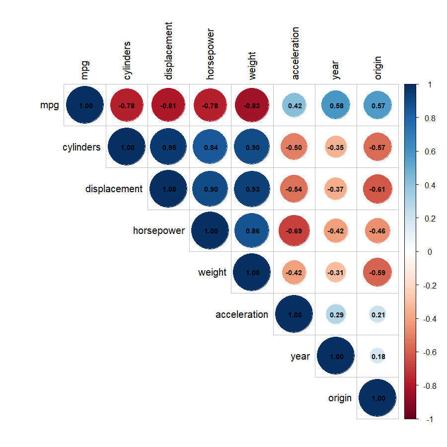

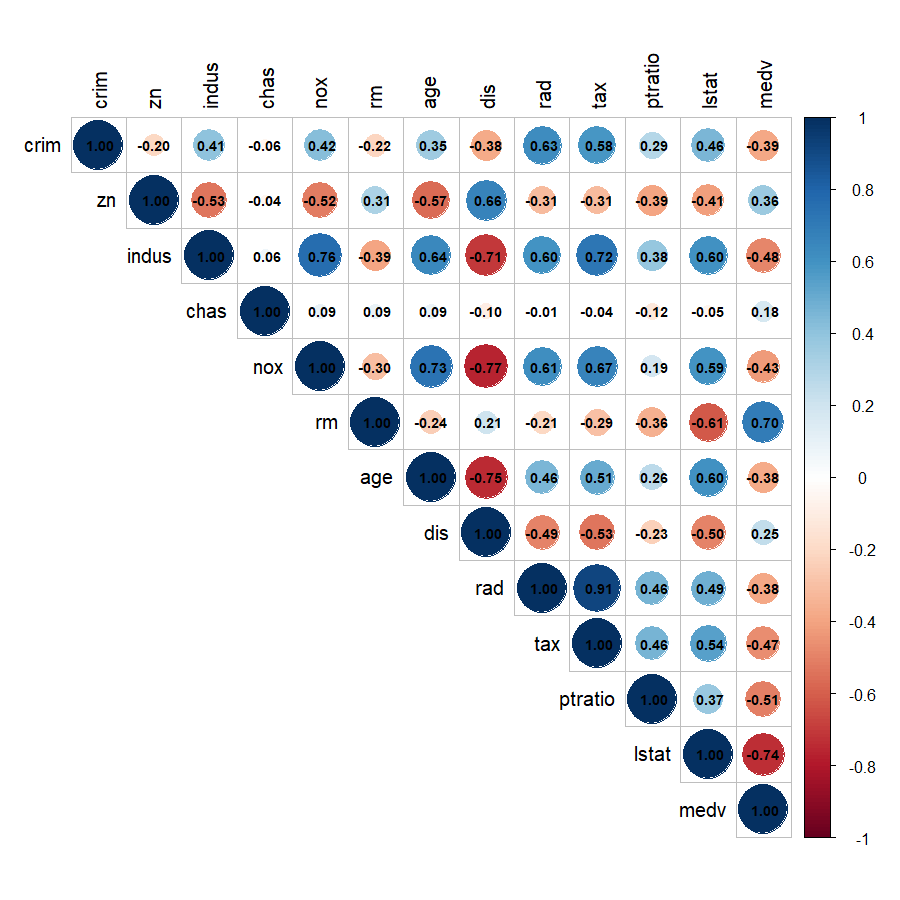

As outras três estão em `graficos/corr_credit.png`, `corr_wage.png` e `corr_carseats.png`.

---

## Etapa 4 - O roteiro repetido em cada exercício

Os 10 exercícios seguem o mesmo roteiro do exemplo da aula:

```r
cor(auto$horsepower, auto$mpg)                 # 1) correlação

modelo01<-lm(mpg ~ horsepower, data = auto)    # 2) ajusta a reta
summary(modelo01)                              # 3) R², p-valor...
formula(modelo01)

b<-as.numeric(modelo01$coefficients[1])        # 4) intercepto
a<-as.numeric(modelo01$coefficients[2])        #    inclinação

x<-auto$horsepower
yaproximado<-a*x+b                             #    y calculado pela reta
head(data.frame(real = auto$mpg, aproximado = round(yaproximado, 2)))

a*100+b                                        # 5) previsão para x = 100
predict(modelo01, data.frame(horsepower = 100))#    mesma conta, feita pelo R

g01<-ggplot(auto, aes(x = horsepower, y = mpg)) +            # 6) gráfico
  geom_point(alpha = 0.6) +
  geom_smooth(method = "lm", se = FALSE, color = "red") +
  labs(title = "Ex. 1 - Regressão Linear: consumo x potência (Auto)",
       subtitle = equacao(modelo01),
       x = "Potência (HP)", y = "Milhas por galão (mpg)")
g01
```

> **Teoria:** `a*x+b` e `predict()` dão exatamente o mesmo resultado (24,15 no exercício 1).
> Fazer a conta "na mão" mostra que o modelo é só uma reta; o `predict()` é o jeito prático.
>
> `geom_smooth(method = "lm")` desenha a mesma reta que o `lm()` calculou. `se = FALSE` tira a
> faixa cinza de incerteza, como no exemplo da aula. `alpha` deixa os pontos transparentes para
> mostrar onde eles se acumulam.

Para não digitar a equação à mão em cada subtítulo, foi criada uma função que monta o texto a
partir do próprio modelo:

```r
equacao<-function(modelo){
  coefs<-modelo$coefficients
  nomes<-all.vars(formula(modelo))
  sprintf("%s = %.4f %s %.4f * %s   |   R² = %.3f",
          nomes[1], coefs[1], ifelse(coefs[2] < 0, "-", "+"), abs(coefs[2]), nomes[2],
          summary(modelo)$r.squared)
}
```

---

## Etapa 5 - Os 10 modelos

Todos os valores abaixo foram copiados da saída do script, não estimados de cabeça.

### Exercício 1 - Auto: `mpg ~ horsepower`

| r | Reta | R² | p-valor | Previsão |
|---|------|----|---------|----------|
| -0,778 | mpg = 39,94 - 0,1578 × horsepower | 0,606 | < 2e-16 | 100 HP → 24,15 mpg |

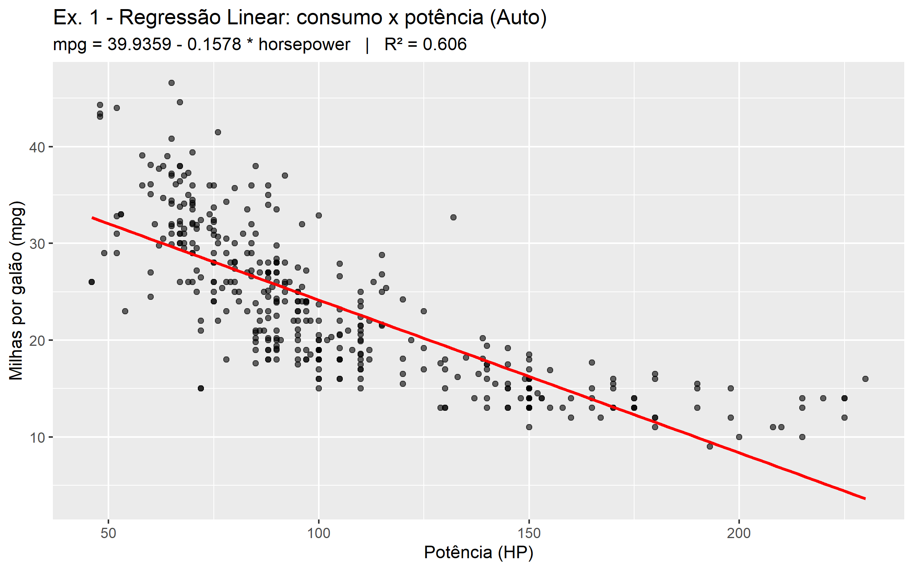

**Interpretação:** correlação negativa forte. Cada 1 HP a mais tira 0,158 mpg (10 HP = -1,6 mpg)
e a potência explica 60,6% da variação do consumo. O gráfico mostra uma **curva**: a reta fica
abaixo dos pontos nas pontas (HP muito baixo ou muito alto) e acima no meio. A reta é uma boa
primeira aproximação, mas não a forma exata da relação.

### Exercício 2 - Auto: `mpg ~ weight`

| r | Reta | R² | p-valor | Previsão |
|---|------|----|---------|----------|
| -0,832 | mpg = 46,22 - 0,00765 × weight | 0,693 | < 2e-16 | 3000 libras → 23,27 mpg |

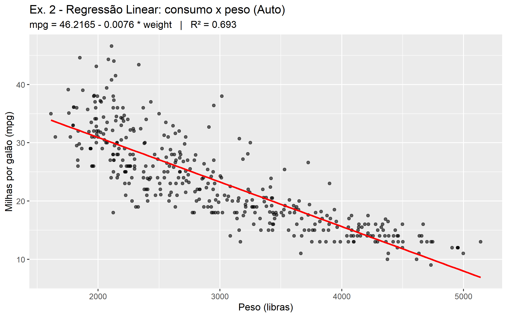

**Interpretação:** a correlação mais forte do Auto. Cada 1000 libras a mais tiram 7,6 mpg, e o
peso explica 69,3% da variação do consumo. É o melhor preditor isolado de `mpg` entre os testados.

### Exercício 3 - Auto: `acceleration ~ horsepower`

| r | Reta | R² | p-valor | Previsão |
|---|------|----|---------|----------|
| -0,689 | acceleration = 20,70 - 0,0494 × horsepower | 0,475 | < 2e-16 | 100 HP → 15,76 s |

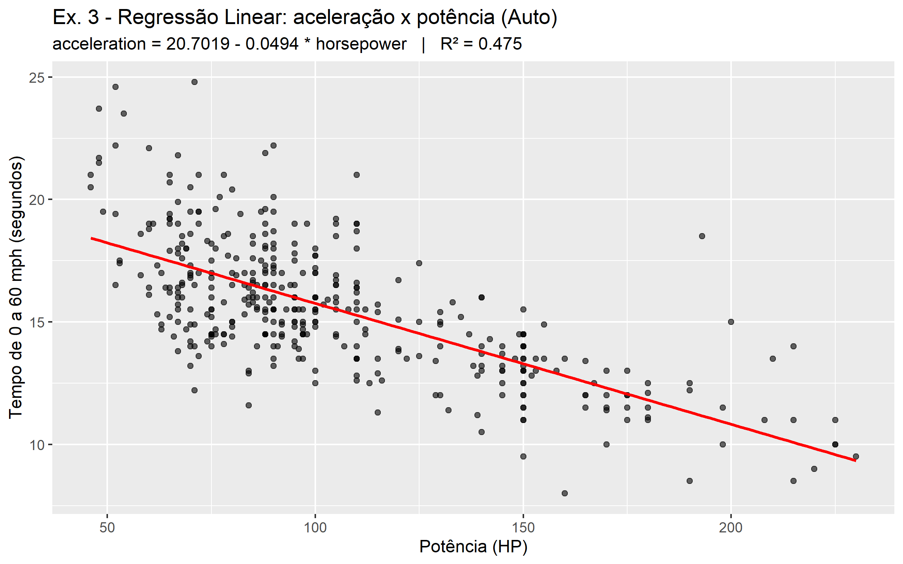

**Interpretação:** `acceleration` é o **tempo** de 0 a 60 mph, então a inclinação negativa quer
dizer que carro mais potente acelera **mais rápido**. Cada 100 HP a mais tiram 4,9 s do 0-60.
A potência explica 47,5% da variação; o resto depende de outros fatores (peso, câmbio...).

### Exercício 4 - Auto: `mpg ~ displacement`

| r | Reta | R² | p-valor | Previsão |
|---|------|----|---------|----------|
| -0,805 | mpg = 35,12 - 0,0601 × displacement | 0,648 | < 2e-16 | 200 pol³ → 23,11 mpg |

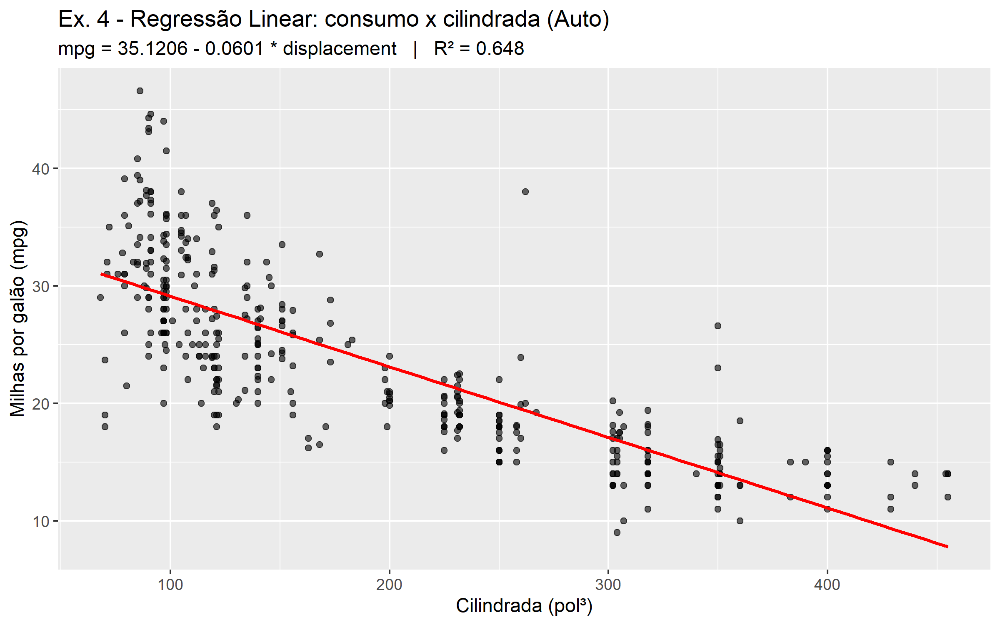

**Interpretação:** cada 100 pol³ de cilindrada a mais tiram 6,0 mpg; a cilindrada explica 64,8%
da variação. Comparando os exercícios 1, 2 e 4: **weight (69%) > displacement (65%) > horsepower (61%)**.
As três medem, no fundo, o "tamanho do carro", por isso dão resultados parecidos.

### Exercício 5 - Credit: `Balance ~ Income`

| r | Reta | R² | p-valor | Previsão |
|---|------|----|---------|----------|
| 0,464 | Balance = 246,51 + 6,048 × Income | 0,215 | < 2e-16 | renda 50 mil → US$ 548,93 |

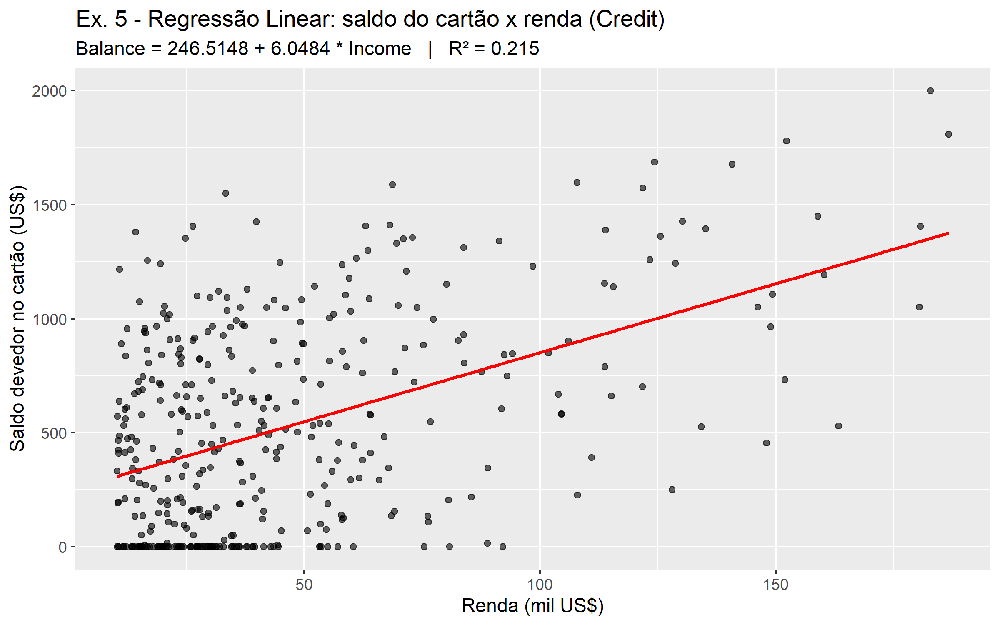

**Interpretação:** correlação positiva moderada: cada 10 mil US$ de renda somam cerca de US$ 60
de saldo. A relação existe (p-valor minúsculo), mas a renda **sozinha** explica só 21,5% do saldo.
O corrplot mostra que `Limit` e `Rating` (r = 0,86) explicam muito mais. Além disso, 90 dos 400
clientes têm saldo zero e formam uma linha no "chão" do gráfico que a reta não acompanha.

### Exercício 6 - Credit: `Balance ~ Age`

| r | Reta | R² | p-valor | Previsão |
|---|------|----|---------|----------|
| 0,002 | Balance = 517,29 + 0,0489 × Age | 0,0000034 | **0,97** | 50 anos → US$ 519,74 |

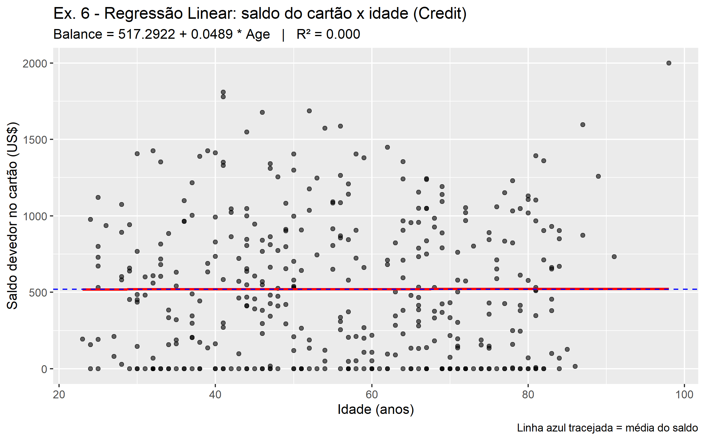

**Interpretação:** é o exemplo de **modelo que não serve**. Correlação praticamente zero,
R² praticamente zero e p-valor = 0,97 (não dá para dizer que a inclinação é diferente de zero).
No gráfico, a reta vermelha cai em cima da linha azul tracejada da média (US$ 520,02): usar o
modelo é o mesmo que chutar a média para todo mundo. A idade não explica o saldo do cartão.

### Exercício 7 - Wage: `wage ~ age`

| r | Reta | R² | p-valor | Previsão |
|---|------|----|---------|----------|
| 0,196 | wage = 81,70 + 0,707 × age | 0,038 | < 2e-16 | 40 anos → 110,0 mil US$/ano |

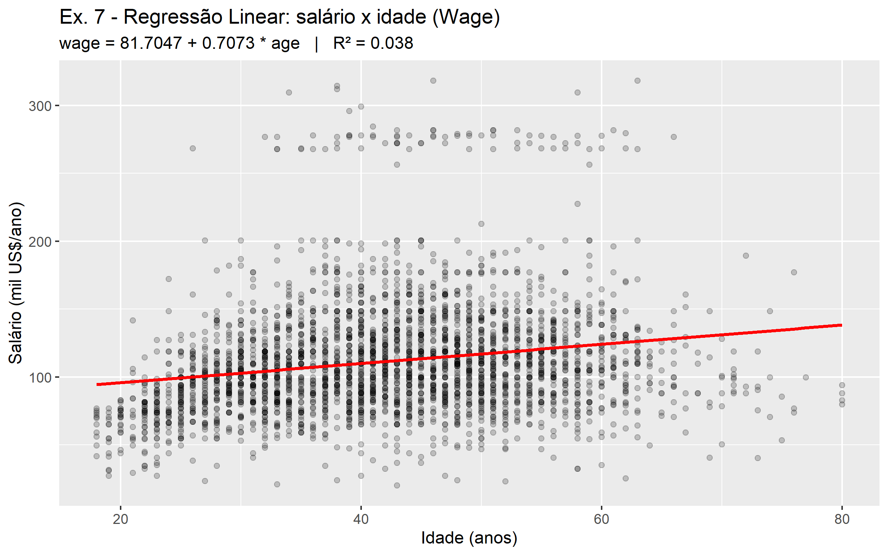

**Interpretação:** correlação positiva **fraca**: cada ano a mais soma cerca de 707 dólares no
salário anual, mas a idade explica só 3,8% da variação. O p-valor é minúsculo porque a base tem
3000 pessoas: com amostra grande, até um efeito pequeno vira "significativo".
**Significativo quer dizer "provavelmente não é zero", não "forte".**

A relação também não é uma reta. O salário médio por faixa de idade mostra uma subida e depois
uma queda:

```r
aggregate(wage ~ cut(age, c(17, 25, 35, 45, 55, 65, 80)), data = wage, FUN = mean)
```

| Faixa | 18-25 | 26-35 | 36-45 | 46-55 | 56-65 | 66-80 |
|-------|-------|-------|-------|-------|-------|-------|
| Salário médio (mil US$) | 76,3 | 104,2 | 119,1 | 117,6 | 119,0 | 102,6 |

Há ainda um grupo de 79 salários acima de 250 mil, separado do resto (faixa de cima do gráfico).

### Exercício 8 - Carseats: `Sales ~ Price`

| r | Reta | R² | p-valor | Previsão |
|---|------|----|---------|----------|
| -0,445 | Sales = 13,64 - 0,0531 × Price | 0,198 | < 2e-16 | US$ 100 → 8,33 mil unidades |

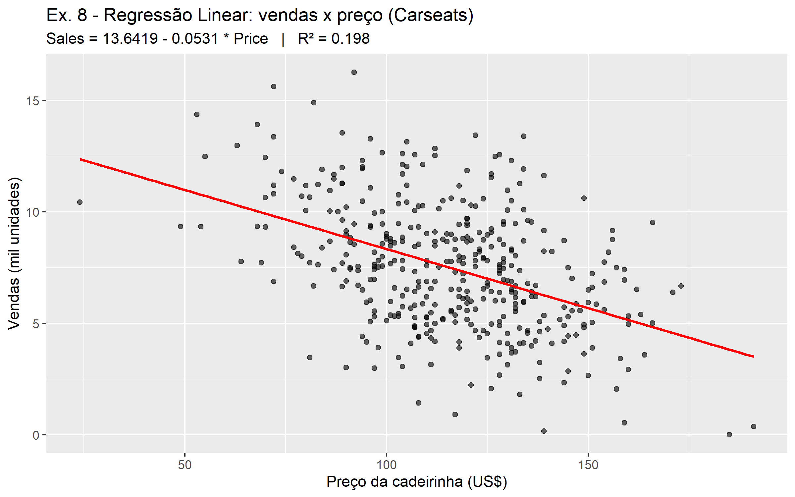

**Interpretação:** correlação negativa moderada, como manda a lei da demanda: cada US$ 10 a mais
no preço tiram cerca de 530 cadeirinhas vendidas. O preço explica 19,8% das vendas; os pontos
ficam espalhados em volta da reta porque outros fatores pesam (qualidade da prateleira,
propaganda, idade da população).

### Exercício 9 - Boston: `medv ~ lstat`

| r | Reta | R² | p-valor | Previsão |
|---|------|----|---------|----------|
| -0,738 | medv = 34,55 - 0,950 × lstat | 0,544 | < 2e-16 | lstat 10% → US$ 25,05 mil |

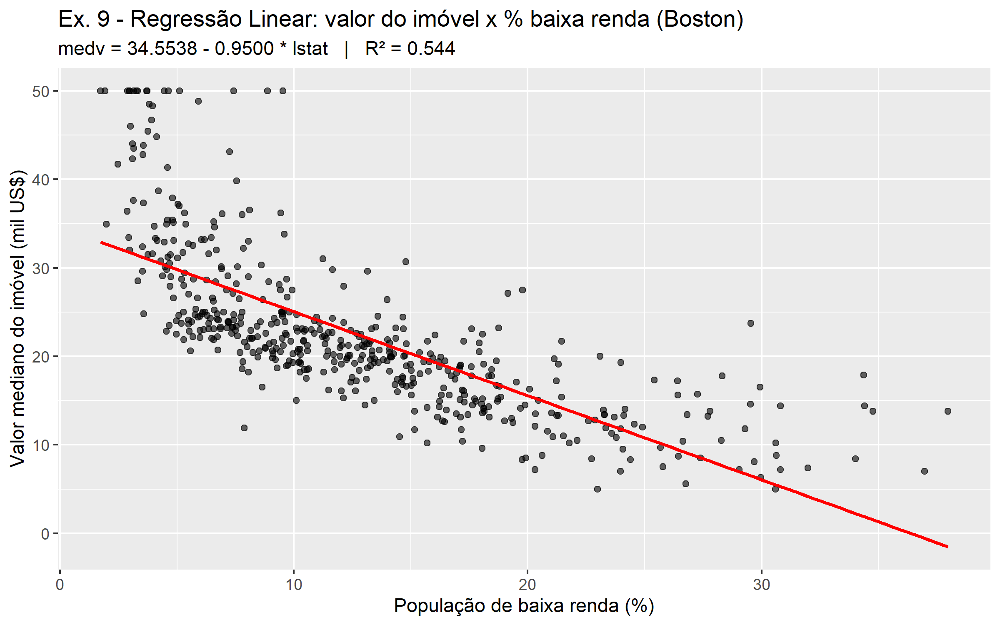

**Interpretação:** correlação negativa forte: cada ponto percentual a mais de população de baixa
renda tira cerca de US$ 950 do valor mediano do imóvel, e `lstat` explica 54,4% da variação.
O gráfico é claramente uma **curva**: a reta fica abaixo dos pontos nos extremos e acima no meio.
Para `lstat` acima de 36,4% a reta daria valor **negativo**, o que não existe (2 bairros estão
nessa faixa).

### Exercício 10 - Boston: `medv ~ rm`

| r | Reta | R² | p-valor | Previsão |
|---|------|----|---------|----------|
| 0,695 | medv = -34,67 + 9,102 × rm | 0,484 | < 2e-16 | 6 cômodos → US$ 19,94 mil |

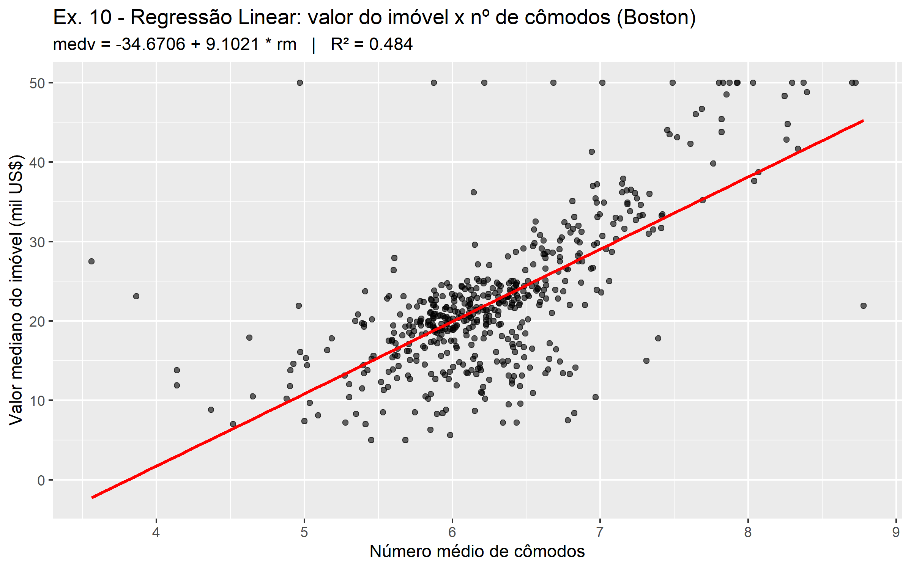

**Interpretação:** correlação positiva forte: cada cômodo a mais soma cerca de US$ 9.100 ao valor
mediano; o número de cômodos explica 48,4% da variação. O **intercepto negativo** (-34,67) não tem
significado prático: seria o valor de um imóvel com zero cômodos, e o menor valor da base é 3,6.
A reta só vale dentro da faixa observada (3,6 a 8,8 cômodos). Os 16 bairros com `medv = 50`
formam uma linha no topo: é o teto da base, não um valor real.

---

## Etapa 6 - Comparar os 10 modelos

> **Teoria:** como R² = r² na regressão simples, dá para recuperar `r` a partir do modelo com
> `sinal(a) * raiz(R²)`. Juntar tudo numa tabela ordenada pelo R² mostra de uma vez quais
> relações são fortes e quais não servem.

```r
modelos<-list(ex01 = modelo01, ex02 = modelo02, ..., ex10 = modelo10)

resumo<-data.frame(
  modelo  = sapply(modelos, function(m) deparse(formula(m))),
  b       = sapply(modelos, function(m) round(m$coefficients[1], 4)),
  a       = sapply(modelos, function(m) round(m$coefficients[2], 4)),
  r       = sapply(modelos, function(m) round(sign(m$coefficients[2]) * sqrt(summary(m)$r.squared), 3)),
  R2      = sapply(modelos, function(m) round(summary(m)$r.squared, 3)),
  p_valor = sapply(modelos, function(m) signif(summary(m)$coefficients[2, 4], 3))
)
resumo[order(-resumo$R2), ]
```

Saída:

| Ex. | Modelo | b | a | r | R² | p-valor |
|-----|--------|---|---|---|----|---------|
| 2 | mpg ~ weight | 46,2165 | -0,0076 | -0,832 | 0,693 | 6,02e-102 |
| 4 | mpg ~ displacement | 35,1206 | -0,0601 | -0,805 | 0,648 | 1,66e-90 |
| 1 | mpg ~ horsepower | 39,9359 | -0,1578 | -0,778 | 0,606 | 7,03e-81 |
| 9 | medv ~ lstat | 34,5538 | -0,9500 | -0,738 | 0,544 | 5,08e-88 |
| 10 | medv ~ rm | -34,6706 | 9,1021 | 0,695 | 0,484 | 2,49e-74 |
| 3 | acceleration ~ horsepower | 20,7019 | -0,0494 | -0,689 | 0,475 | 1,58e-56 |
| 5 | Balance ~ Income | 246,5148 | 6,0484 | 0,464 | 0,215 | 1,03e-22 |
| 8 | Sales ~ Price | 13,6419 | -0,0531 | -0,445 | 0,198 | 7,62e-21 |
| 7 | wage ~ age | 81,7047 | 0,7073 | 0,196 | 0,038 | 2,90e-27 |
| 6 | Balance ~ Age | 517,2922 | 0,0489 | 0,002 | 0,000 | 0,971 |

**Conclusões gerais:**

1. **Relações fortes** (R² ≥ 0,5): `mpg` com peso, cilindrada e potência; `medv` com `lstat`.
2. **Relações moderadas** (R² ~0,5): `medv ~ rm` e `acceleration ~ horsepower`.
3. **Relações reais, mas fracas** (R² 0,04 a 0,22): renda → saldo, preço → vendas, idade → salário.
   Uma variável só não basta para prever bem.
4. **Sem relação:** `Balance ~ Age` (p = 0,97).
5. **Olhar sempre o gráfico, não só o R²:** nos exercícios 1, 7, 9 e 10 a reta é significativa,
   mas os pontos formam uma curva ou têm grupos separados. O modelo linear é o ponto de partida,
   não necessariamente a forma certa da relação.

---

## Etapa 7 - Salvar os gráficos

> **Teoria:** guardar cada gráfico num objeto (`g01`, `g02`...) e colocar todos numa lista
> permite salvar com um `for` só. O nome da lista vira o nome do arquivo.

```r
graficos<-list(ex01_auto_mpg_horsepower = g01,
               ex02_auto_mpg_weight     = g02,
               ...
               ex10_boston_medv_rm      = g10)

for (nome in names(graficos)) {
  ggsave(file.path(SAIDA, paste0(nome, ".png")), graficos[[nome]],
         width = 8, height = 5, bg = "white")
}
```

**Como rodar:** abrir o RStudio pelo `Aulas_R.Rproj` e rodar o script inteiro (Ctrl+Shift+S),
ou no terminal, a partir da pasta `Aulas_R`:

```r
source("Aula11/Tarefa008/tarefa008_WellingtonTorres.R", echo = TRUE)
```

---

## Problemas encontrados no caminho (e como foram resolvidos)

| Problema | Causa | Solução |
|----------|-------|---------|
| `ISLR2` e `corrplot` não estavam instalados | Pacotes novos nesta tarefa | `install.packages(c("ISLR2", "corrplot"))` uma vez |
| Aviso `The following objects are masked from 'package:ISLR': Auto, Credit` | O `ISLR2` também tem bases `Auto` e `Credit`; quem é carregado por último "ganha" | Sempre indicar o pacote com `::` (`ISLR::Auto`, `ISLR::Credit`), como no enunciado |
| `cor(auto)` dá erro `'x' must be numeric` | A coluna `name` é fator (texto) | Filtrar as numéricas com `sapply(dados, is.numeric)` |
| Ao rodar pelo terminal (`Rscript`) apareceu um `Rplots.pdf` em `Aulas_R` | Fora do RStudio, os gráficos "na tela" vão para esse PDF | Arquivo apagado; no RStudio isso não acontece |
| Comentários do script com valores errados (ex. 6: R² = 0,00001; ex. 7: previsão 109,99) | Valores escritos antes de conferir a saída | Script rodado, cada número comparado com a saída e corrigido (R² = `3.368e-06`; previsão = 110,00) |

Cuidados tomados de antemão (não chegaram a dar problema, mas dariam):

| Cuidado | Por quê |
|---------|---------|
| Tirar `ID` do corrplot do Credit (`credit_num$ID<-NULL`) | É numérica, mas é só o número da linha, não uma medida |
| `png()` + `corrplot()` + `dev.off()` em vez de `ggsave()` | O `corrplot` usa o gráfico base do R, não o ggplot |
| `geom_point(alpha = 0.2)` no ex. 7 | São 3000 pontos; sem transparência viram uma mancha |
| Conferir a unidade de `acceleration` em `?Auto` | É **tempo** de 0 a 60 mph: inclinação negativa = carro mais rápido, não mais lento |
| Interpretações de curvatura conferidas nos números | Média dos resíduos por faixa de X: positiva nas pontas e negativa no meio (ex. 1, 9 e 10) |

A lição é a mesma da Aula 09: **toda frase de interpretação tem que sair de um número que você
imprimiu** e da unidade certa da variável.

---

## Resumo das funções usadas

| Etapa | Função | Para que serve |
|-------|--------|----------------|
| Ambiente | `rm()`, `file.path()`, `dir.create()`, `install.packages()` | Limpar memória, caminhos e pacotes |
| Inspeção | `str()`, `is.numeric()`, `sapply()` | Ver tipos e filtrar colunas numéricas |
| Correlação | `cor()`, `corrplot()` | Força e sentido das relações |
| Modelo | `lm()`, `summary()`, `formula()`, `$coefficients` | Ajustar e ler a reta |
| Previsão | `a*x+b`, `predict()` | Calcular y para um x escolhido |
| Resumo | `aggregate()`, `cut()`, `data.frame()`, `order()` | Médias por faixa e tabela comparativa |
| Gráfico | `geom_point()`, `geom_smooth(method = "lm")`, `geom_hline()`, `labs()` | Pontos, reta e média |
| Saída | `ggsave()`, `png()` + `dev.off()` | Gravar PNG |
